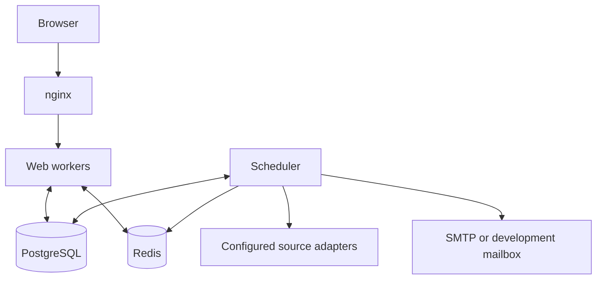

# Architecture Overview

FastAPI serves a local PostgreSQL catalogue. A separate scheduler ingests
explicitly configured sources, delivers queued email and runs maintenance.
Both processes require `SOURCES_CONFIG_FILE` and retain their selected source
snapshot until restart.

## The big picture

The shipped deployment uses TLS at nginx and a Unix socket to Gunicorn. Jinja2 renders the UI. Web requests enqueue email; the scheduler delivers it. Hardened environments require a dedicated Redis rate-limit backend; catalogue-cache pub/sub uses separately configured, optional Redis. Both processes log to stdout. See [Deployment](../configuration/deployment.md) for proxy, service, and logging configuration.

## What lives where

| Location | Responsibility |
|---|---|
| `src/app/main.py` | Web startup, middleware, and error handlers |
| `run.py`, `run_scheduler.py` | Web and scheduler process entry points |
| `src/app/routes/`, `src/app/route_security.py` | Handlers and enforced route policies |
| `src/app/middleware/` | Admission, sessions, CSRF, auditing, and headers |
| `src/app/services/` | Authentication, storage, harvesting, email, and jobs |
| `src/app/sources/` | Source contracts, validated descriptions, construction registry and harvest adapters |
| `src/app/templates/`, `src/app/static/` | HTML and static assets |
| `src/config/` | Settings and logging |
| `src/alembic/` | Database migrations |
| `src/tests/` | Unit, client, and integration tests |

## What happens at web startup

`app.main.lifespan` performs these steps before serving requests:

1. Configure logging and, in development, warn about unused `.env` keys.
2. Require the web process role, validate security settings, and load nonsecret
   metadata and pure policy from the explicitly selected source file. No fetch
   adapters or feed credentials are constructed; selected feed credential
   variables in the web environment abort startup.
3. Validate route policy and the rate-limit backend; load the password blocklist
   and warm the dummy Argon2 hash.
4. In development, upgrade Alembic to head. Hardened deployments migrate separately.
5. Open the ordinary pool and validate schema/runtime roles. Open the separate
   one-connection search pool after publishing the catalogue policy below.
6. Reconcile the federation-policy fingerprint and revoke incompatible sessions.
   Verify the durable search-policy binding, then publish the detached source
   metadata and compiled catalogue policy. A changed binding needs an explicit
   operator transition; restarting a worker cannot overwrite it.
7. Create the lazy catalogue cache for the selected source names and its optional
   Redis subscriber.

Shutdown stops the cache subscriber and closes both database pools, including
after startup failure. Web startup does not provision source-status rows or
harvest records. Create the initial administrator with the
[bootstrap command](../runbooks/bootstrap-admin.md).

Every catalogue read checks the durable policy fingerprint inside its database
transaction. Public statistics also check before returning a warm cache entry;
their guard, freshness lookup and live count share one connection. A worker
whose policy has been replaced returns the controlled unavailable response
until it loads the current configuration. Operator policy changes cannot race
with a guarded read to expose a mixture of old and new disclosure rules.

`run_scheduler.py` independently validates settings and selects sources, opens
PostgreSQL, checks schema/role contracts and provisions the selected source-status
rows before registering jobs. Each source receives incremental and rebuild jobs
with its own schedule; maintenance jobs remain shared. Initial unbound-source
recovery can immediately initiate a rebuild through the scheduler wrapper.
Catalogue population, including development fixture data, uses normal ingestion.

The scheduler does not run web migrations or administrator seeding. See
[Sources](../sources/index.md), [Deployment](../configuration/deployment.md) and
[Source Ingestion Pipeline](sync.md).

## How a request flows

Application middleware runs inbound in this order:

1. TrustedHost and optional CORS.
2. Audit logging.
3. Database-capacity error handling.
4. Bounded rate admission.
5. Session resolution and recovery-session restrictions.
6. Security headers and CSRF cookie maintenance.
7. Exact route-policy dependencies and the handler.

Rate-limit refusals precede session database work; audit wraps both. The database-capacity layer converts pool exhaustion into a retryable 503. Route dependencies enforce access, form Content-Type, and CSRF rules. Recovery sessions also have a middleware-level exact method/path restriction. See [Request Lifecycle](request-lifecycle.md).

## Where data lives

PostgreSQL stores catalogue rows, user credentials and authority, sessions, recovery-code generations, administrator invitations, outbox messages, sync state, and federation-policy state. Action-token hashes live on `users`; plaintext outbox bodies and TOTP secrets use separate encryption key rings.

[Data Model](data-model.md) defines the tables and redaction boundary. Runtime preflight checks application contracts, database schema, Alembic head, and process privileges before either process starts.

## Where to read next

| To understand... | Read |
|---|---|
| ...how a single request becomes a response | [Request Lifecycle](request-lifecycle.md) |
| ...the dataset and user dataclasses, and what's in PostgreSQL | [Data Model](data-model.md) |
| ...how login, registration, TOTP, email verification, and sessions fit together | [Authentication & Sessions](auth.md) |
| ...how visibility tiers are enforced | [Access Control & Visibility](access-control.md) |
| ...how configured-source ingestion works | [Source Ingestion Pipeline](sync.md) |
| ...how to configure or implement sources | [Sources](../sources/index.md) |
| ...the layered security controls | [Security Layers](security.md) |
